# Craftax 3D

This repo upgrades the [Craftax benchmark game](https://github.com/MichaelTMatthews/Craftax) created at Oxford university with a 3D animated experience, and refined gameplay for desktop and mobile.

**[Play it at playcraftax.com](https://playcraftax.com)**

Designed for both humans and AI, you can play the game, watch a variety of pre-trained agents, or test your own agents. Record games, replay from any angle, and share via video or an embeddable player that you can include on your site.

Craftax 3D was built by Pete DeLaurentis with [Shellcaster](https://shellcaster.com), an IDE for building complex projects with agents.

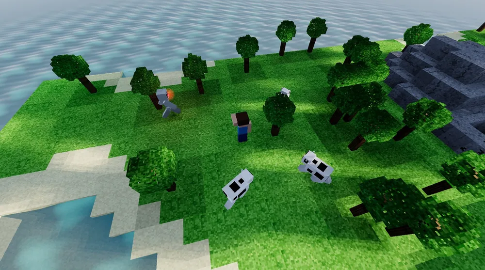

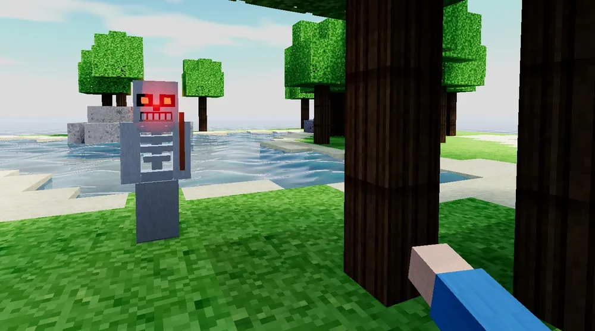

## The projects

Building Craftax 3D meant building several new open-source packages alongside it, and they work together. Its rules run in craftax-wasm, a C port of Craftax checked against the JAX original (Craftax-Symbolic, craftax 1.6.1): over 256 seeds of 1,000 random actions each, it builds the same worlds on all 9 floors and gives the same observations at every step. A seed you train on in JAX makes the same world here.

| Project | What it does |
|---|---|
| **craftax-3d** (this one) | The game in your browser: the 3D views, the HUD, touch controls, watching agents, recording and replay. |
| [craftax-wasm](https://github.com/delaurentis/craftax-wasm) | The game engine: Craftax rewritten in C and compiled to WebAssembly, playing exactly like the JAX original. It also builds for Python and servers. It starts from PufferLib's C port. |
| [craftax-agents](https://github.com/delaurentis/craftax-agents) | The players that run trained agents on computers and phones, the agent list, and how to add your own. The agents themselves come from their own authors (PufferLib, priml, the Craftax paper and others), converted to run here. |
| [craftax-crystal](https://github.com/delaurentis/craftax-crystal) | A plugin that adds agents made of trained optical glass, simulated in the browser. |
| [playcraftax.com](https://playcraftax.com) | All of it, live. |

## Survive, craft, dungeon crawl

Craftax combines survival (food, water, sleep), mining, and crafting with a multi-level dungeon crawler. 

Every floor is here, from the overworld down through the dungeon, the gnomish mines and the sewers to the necromancer's graveyard, with the same creatures, crafting and achievements as Craftax. There's no game server: everything runs in the browser, your world autosaves until you die, and a death is final.

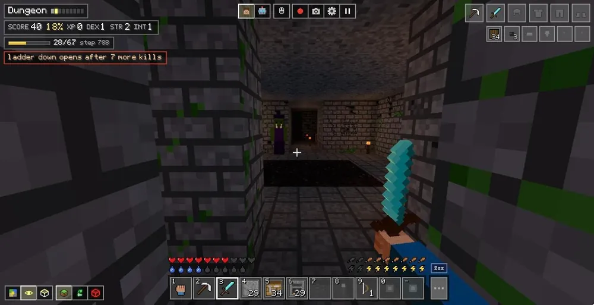

*The Dungeon, the first floor down, reached here by a trained agent.*

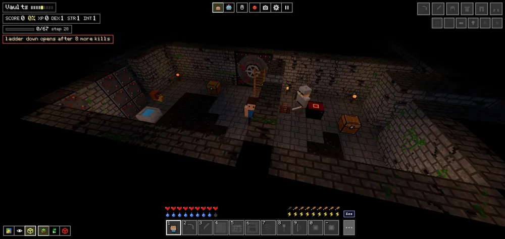

*The Vaults, four floors down, where knights guard the treasure.*

## Three views

Play in first person (V), from a bird's-eye camera that orbits above you (B), or in Craftax's classic 2D view with its original art (C).

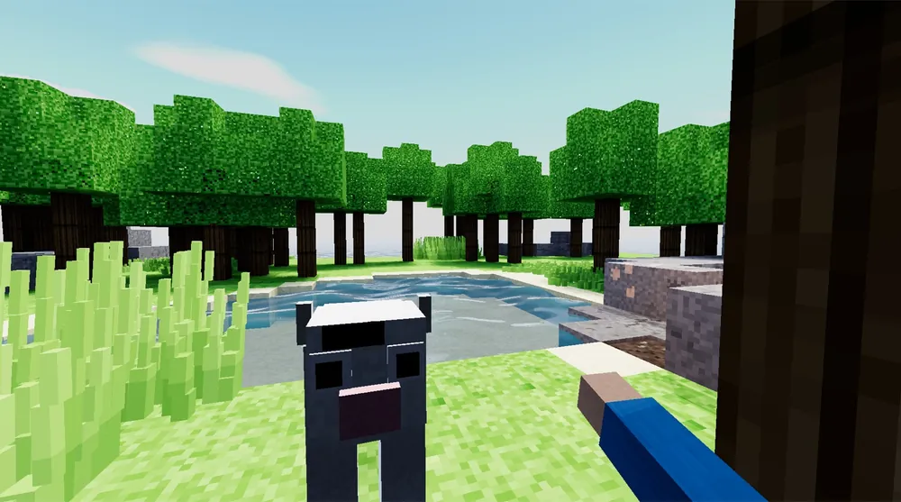

## Looks

M switches how the world is drawn at any time: color, laser (the world as glowing red outlines) or phosphor (an old green screen).

Plugins can add looks of their own, with their own button. Two come with the game, off by default: Noir (black and white film) and Pixel (pixel art in 16 colors). See [Writing a look](doc/looks.md).

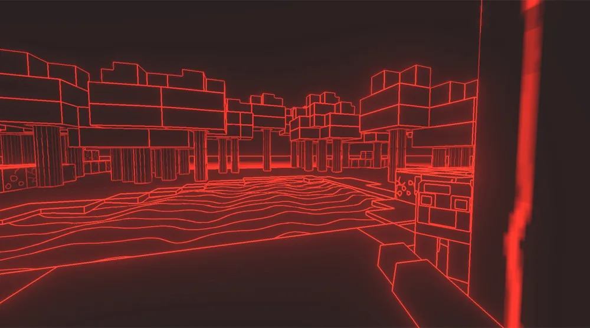

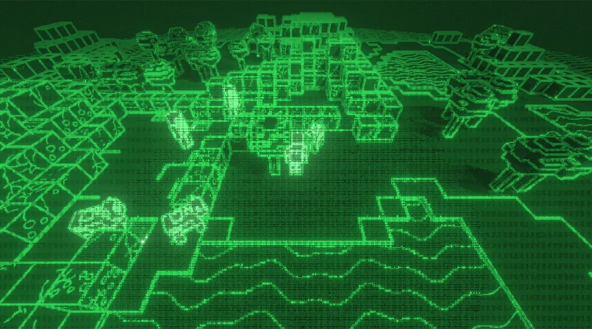

## Themes

Themes come from plugins, and T cycles through whatever is installed. Winter, Ruins and Tropical come with the game and are on by default. A theme changes only the drawing, never the game: in Winter the ground is under snow, the trees are firs and the cows become reindeer, but it's the same world, step for step. A plugin system is provided and you can learn how to create your own plugins and themes [here](doc/themes.md).

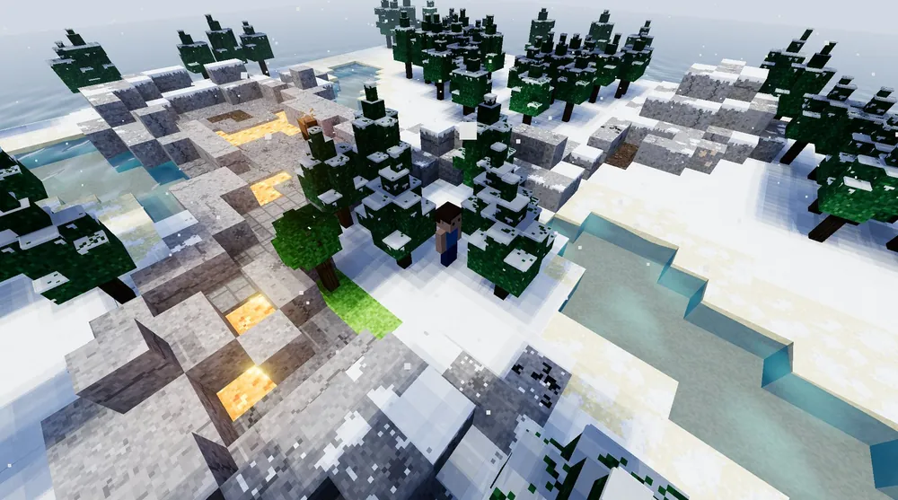

## Watch an agent play

Press **P**, or the robot button at the top, and a bot takes over from where you are. The bot panel shows which action it chose and how likely each one was. On a computer, any Craftax agent exported to ONNX can play. Phones have less memory, so there each agent runs on a lighter player made for it, and a few agents play on computers only. To add your own, see [Extend it](#extend-it).

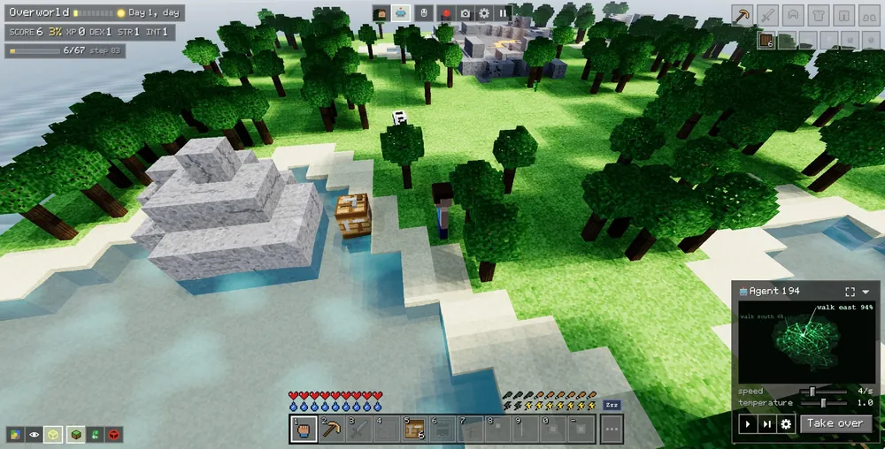

## A brain made of glass

Craftax 3D supports custom neural network types including simulations of optical neural networks. NeuralCrystal 27 is a block of glass with trained surfaces inside it, and it decides each move with light. The game simulates that light in your browser.

Open its panel full size to watch it think. What the agent sees goes in on the left, light crosses the crystal, and the action it picks comes out on the right. Its memory loops back around for the next move.

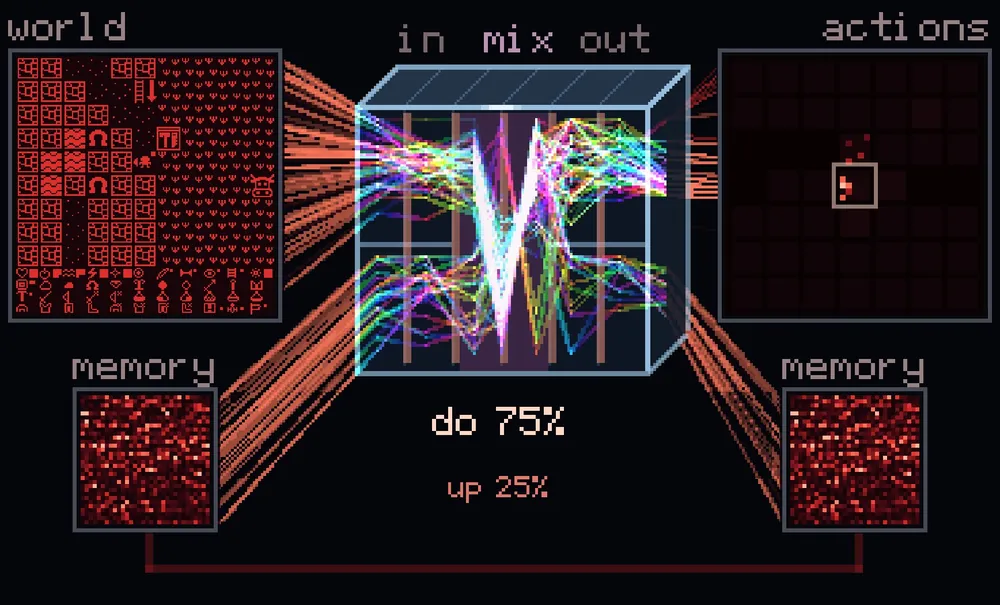

- [craftax-crystal](https://github.com/delaurentis/craftax-crystal): the plugin that adds crystal agents to the game. playcraftax.com has it installed.
- [The crystal on Hugging Face](https://huggingface.co/neuralcrystal/craftax-crystal): its trained weights.
- [NeuralCrystal](https://neuralcrystal.com): the project behind it, with the [code on GitHub](https://github.com/neuralcrystal/neuralcrystal).

## Record and replay

Record a stretch of a game, then on the replay page trim it and set camera keyframes (each with its own view, look and theme).

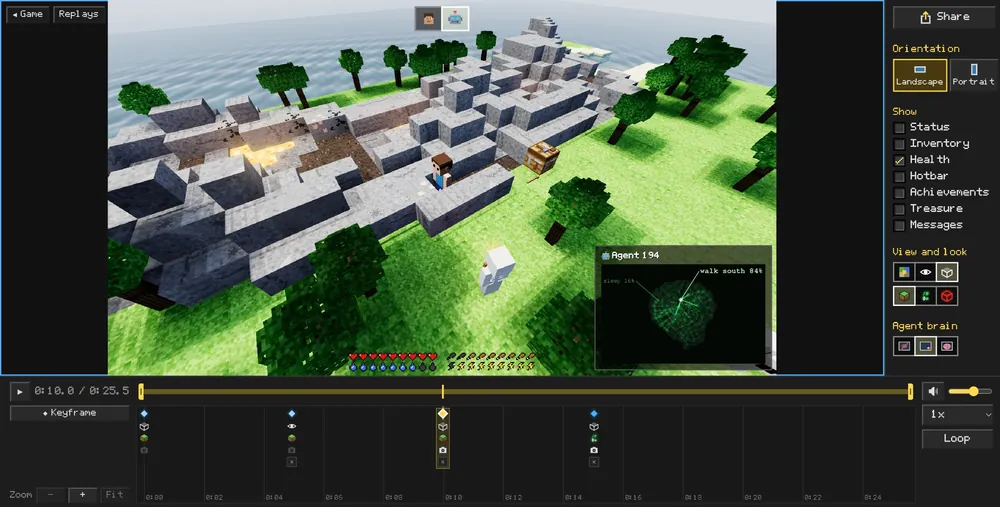

Then make a video of it, or share it as a replay that plays in 3D on your own site. Share → Put it on the web gives you the embed code for the player. It looks like this:

```html
<iframe src="https://playcraftax.com/replay/?r=YOUR_REPLAY_ID&embed&aspect=16x9"
        width="720" height="405" style="border:0"
        allow="autoplay; fullscreen" loading="lazy"></iframe>
```

The embed can be 16:9, 9:16, or adaptive, filling whatever box your page gives it.

## Plays on phones too

On a touch screen the left thumb walks with the pad, the right thumb presses Use, and dragging on the world looks around.

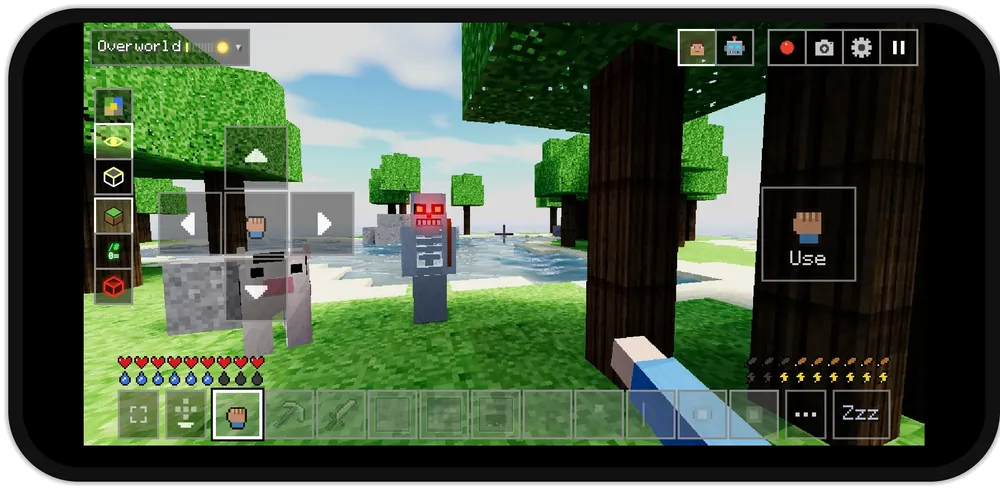

For a more casual game, tap or click anywhere in the bird's-eye view: the player walks there and acts on what's there, whether that's a tree to chop, a cow or a zombie. It works with a mouse too.

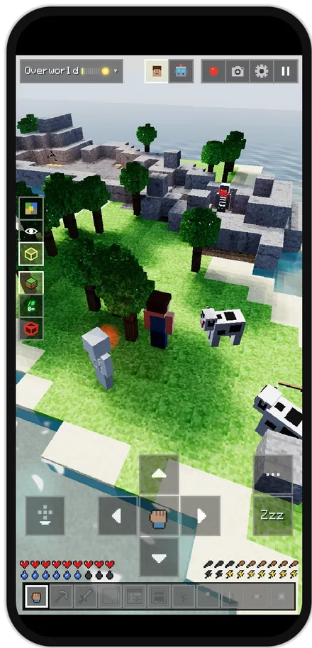

## Controls

| Keys | What they do |
|---|---|
| W A S D | walk |
| mouse or arrow keys | look around |
| click or Space | act on the tile ahead |
| 1 to 0, − | pick a hotbar slot |
| E | inventory and crafting |
| X | place a block ahead |
| Z | sleep (Zzz...) |
| V | first person |
| B | bird's-eye |
| C | classic 2D |
| M | color, phosphor, laser (Shift+M goes back) |
| T | the next theme (Shift+T goes back) |
| P | an agent plays / take over |
| H | every key |

## Run it

You need Node 20 or newer. The game uses two of the other projects, the engine and the agents, and there are two ways to get them.

### Just this repo

The engine and the agents come from npm, ready to use:

```sh
git clone https://github.com/delaurentis/craftax-3d
cd craftax-3d
npm install
npm run dev
```

### All of them, to change them too

Clone the repositories side by side in one folder:

```sh
mkdir craftax && cd craftax
git clone https://github.com/delaurentis/craftax-3d
git clone https://github.com/delaurentis/craftax-wasm
git clone https://github.com/delaurentis/craftax-agents
```

Beside them, add a `package.json` that makes the folder an npm workspace:

```json
{
  "private": true,
  "workspaces": ["craftax-wasm", "craftax-agents", "craftax-3d"]
}
```

Build the engine once, with [Emscripten](https://emscripten.org) installed:

```sh
cd craftax-wasm
make wasm
```

Then install the game and start it:

```sh
cd ../craftax-3d
npm install
npm run dev
```

npm now links the repositories in the folder to each other instead of downloading them, so the game runs your copies. An edit to the agents' players shows on reload, and a rebuilt engine is picked up the next time you start the game. A repository left out of the folder and the list comes from npm instead. To work on the crystal plugin too, clone [craftax-crystal](https://github.com/delaurentis/craftax-crystal) into the folder and add it to the list.

| Command | What it does |
|---|---|
| `npm run dev` | opens the game at localhost:8795, reloading as you edit |
| `npm run build` | makes a static site in the dist folder, for any web host |
| `npm run check` | checks the types and file sizes |

See [CONTRIBUTING.md](CONTRIBUTING.md) before opening a pull request.

## Extend it

There are two ways to add to the game without changing its code.

**Plugins** add themes, set pieces, analytics, replay sharing, or a new kind of bot. The game comes with a few, switched on by listing them in `craftax.config.ts`: the Winter, Ruins and Tropical themes (on by default), the University scene pack's set pieces, the Noir and Pixel looks, and Autumn, one file a player can add from Settings → World.

Turn a plugin on by importing it in `craftax.config.ts` and adding it to `plugins`. Leave it out and it isn't in the build:

```ts
import winter from "./plugins/winter";
import noir from "./plugins/noir";

const config: CraftaxConfig = { site: "https://playcraftax.com", plugins: [winter(), noir()] };
```

- [Themes and scene packs](doc/themes.md): how to write a plugin and install it.
- [Writing a look](doc/looks.md): a new way to draw the world, with Noir and Pixel as examples.
- [craftax-crystal](https://github.com/delaurentis/craftax-crystal): a plugin that adds a new kind of bot.

**Agents** come from craftax-agents. Add your own trained agent, or write a new kind of player to run agents on phones.

- [Add your agent](https://github.com/delaurentis/craftax-agents#add-your-agent): export, check and list it.
- [The playable format](https://github.com/delaurentis/craftax-agents/blob/main/FORMAT.md): what an agent takes and returns, and how to write a new player.

## How it's built

| Folder | What's in it |
|---|---|
| `plugin.ts` | the plugin API: everything a plugin may use from the game, imported as `craftax-3d/plugin` |
| `src/core/` | the plugin system (`plugins.ts`) and the game's events (`events.ts`) |
| `src/config.ts`, `craftax.config.ts` | which plugins a copy of the game loads, and its home site |
| `js/` | the game: rendering, the HUD, input, bots, recording and replay |
| `public/` | art, sounds, fonts and the bot registry, served as they are |
| `plugins/` | example plugins |
| `doc/` | how the system fits together (`doc/components.html`, `doc/themes.md`) |

## Credits

Craftax is by Michael Matthews and colleagues at Oxford ([paper](https://arxiv.org/abs/2402.16801)), built on Crafter by Danijar Hafner. 

The C engine starts from PufferLib's port. Craftax's own art is used in the classic view under its MIT license; the 3D block textures are drawn by code; every recorded sound is CC0. See [NOTICE.md](NOTICE.md).

If you use Craftax 3D in research, please cite it along with the original Craftax project.

The repos below were built by Pete DeLaurentis using Opus 5.5 and [Shellcaster](https://shellcaster.com):

- [craftax-3d](https://github.com/delaurentis/craftax-3d)
- [craftax-wasm](https://github.com/delaurentis/craftax-wasm)
- [craftax-agents](https://github.com/delaurentis/craftax-agents)
- [craftax-crystal](https://github.com/delaurentis/craftax-crystal)

## License

MIT. See [LICENSE](LICENSE). 