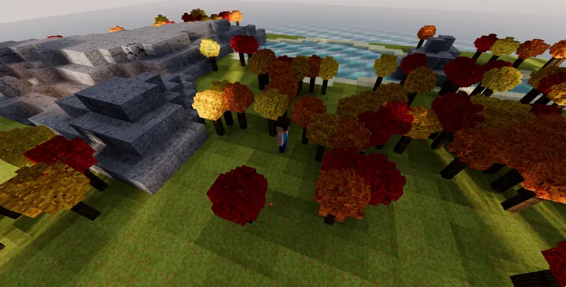
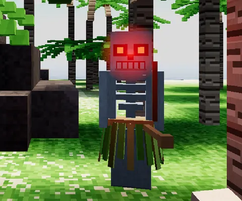
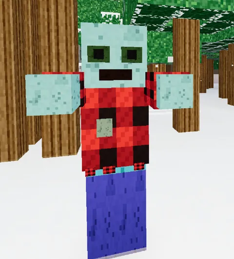
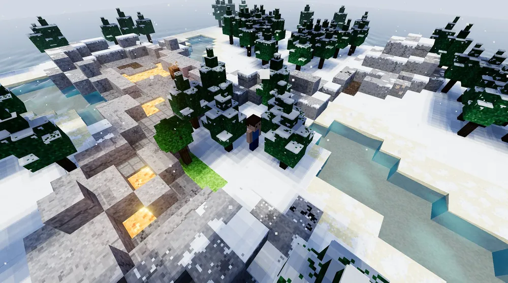
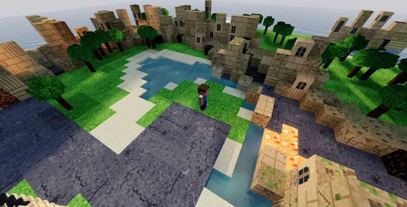
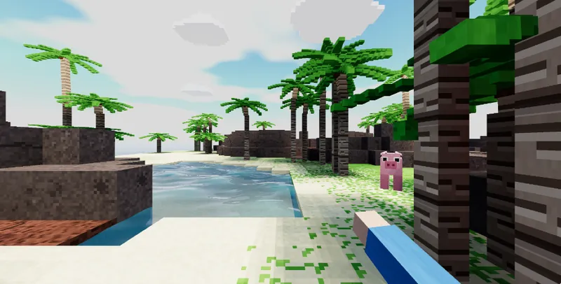
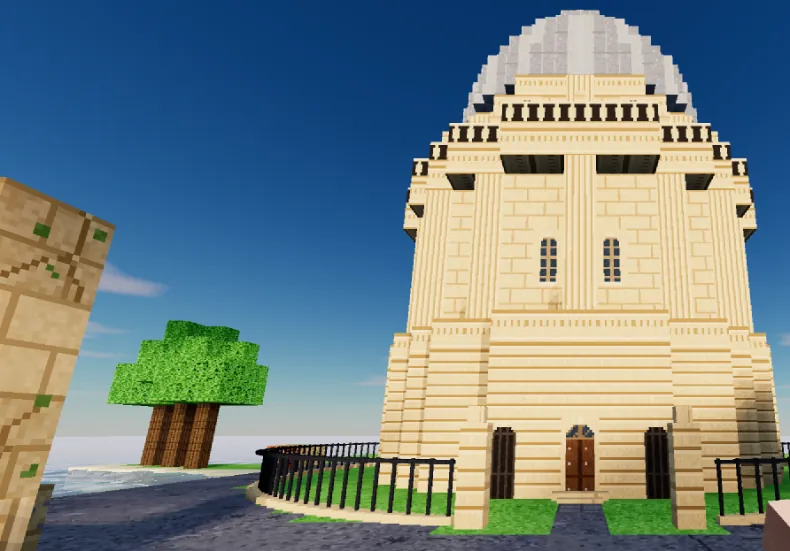

# Themes and scene packs

The game has three independent choices for how you see it:

- **View** (V, B, C): where the camera is: first person, the bird's-eye view, or the classic 2D game.
- **Look** (M): how it's rendered: color, phosphor, laser, or a plugin's own look. A look stays picked in every view. In the classic view it shows its own picture if it has one (laser with the crystal plugin: what the crystal sees), or else Craftax's original 2D art. [Writing a look](looks.md) shows how to add one.
- **Theme** (T): what the world is drawn *as*: the blocks' textures and shapes, the creatures, you, the item icons, the sky, fog and light.

A theme never changes the game. The engine, the bots, recordings and replays are exactly the same with any theme: a recording made in one theme plays back step for step in another. Only the drawing changes.

T cycles Standard → each installed theme → Standard (Shift+T goes back), with a flash "Theme: <label>". The choice is saved per player (localStorage `craftax3d.theme`), and Settings → World has the same choice under 3D grass once a theme is installed. T works in replays too (press it on the replay page).

A plugin that provides themes and/or set pieces is a **scene pack**: `provides: ["theme", "setPieces"]`.

## Try one in five minutes

The Autumn sample is a whole theme in one file, `examples/plugins/autumn.js`. To see it, start the game:

```sh
npm run dev
```

Then in the game open Settings → World, press More… beside the theme, and give it this address:

```
http://localhost:8795/examples/plugins/autumn.js
```

Press T until it says Autumn. The game keeps the address and loads it again each time the page loads, so after an edit to the file a reload shows your change. `src/themes/types.ts` is the full interface with comments, and the reference for everything below.

## What a plugin may use

A plugin uses the game only through its plugin API, `plugin.ts` at the repository's root, imported as `"craftax-3d/plugin"`. The game's other files can change from one release to the next; this one is kept stable. It has:

- **types**: every slot's interface (`Plugin`, `PluginHost`, `Theme`, `SetPieces`, `Weather`, `BotSource`, `Telemetry`…), `Sound`, `RGB`;
- **blocks**: `B` (Craftax's block ids by name: `B.TREE`, `B.STONE`…) and `ORE`;
- **paint**: painting 16 × 16 tiles as the game does: `S`, `R` and `rnd` (its seeded random numbers), `hex`, `rgb`, `px`, `noise`, `specks`, the base colors `SAND`, `SNOW`, `STONE`, `STONE_VARIANTS`, and `standardTile(name)` / `standardOutline(name)`, a tile the game has and its laser drawing, painted as the game paints them, to draw over;
- **models**: a creature's parts, shaded like the game's own: `U`, `part`, `quadruped`, `haloMaterial`;
- **hud**: an item's pixels and icon as the HUD draws them: `toolPixels`, `iconURL`;
- **orient**: `orient` and `SIDES`, for set pieces that face any side.

A plugin built into a copy of the game (listed in `craftax.config.ts`) imports these, plus `"three"`, and nothing else of the game. `npm run check` holds `plugins/` to that: no other game file, and no other plugin's files (`plugins/shared/` holds the helpers the example plugins share, such as the building stone Ruins and University both use).

A plugin a player adds by hand (the More... button beside the theme in Settings → World) is one plain JavaScript file and can't import anything. Its setup is handed the same things: `host.three` (the game's three.js) and `host.kit`, the API grouped as `host.kit.blocks`, `.paint`, `.models`, `.hud` and `.orient`. `examples/plugins/autumn.js` is one.

## Writing a theme

A theme is an object with an `id`, a `label` and only the parts it changes (the full interface, with comments, is in `src/themes/types.ts`). This is the Autumn sample's, from `examples/plugins/autumn.js`, where its painters (`grass`, `leavesIn`…) and falling leaves are written out:

```js
host.add("theme", {
  id: "autumn",
  label: "Autumn",
  // its icon on the replay page's keyframe row (optional): an inline SVG drawn at 16 × 16, or a letter; without one it shows a T
  icon: '<svg viewBox="0 0 20 20" width="16" height="16">…</svg>',
  // repaint tiles the game already has (block faces, and HUD icons such as i_torch): crossfades, no geometry changes
  paint: { grass_top: grass(), grass_top2: grass(), grass_top3: grass(), grass_side: grassSide, grass_blade: blade, leaves: leavesIn("autumn_orange") },
  // tiles of its own: leaves in four colors
  tiles: Object.fromEntries(NAMES.map((n) => [n, { paint: leavesIn(n) }])),
  // which tile a face uses (undefined: keep it): each tree's crown in its own color, picked by where the tree stands
  tile: (name, at) => (name === "leaves" ? shadeOf(at.r, at.c) : undefined),
  // what flies when you cut the grass, and when a tree comes down
  bits: { grass: [0x8f9a3a, 0xa8a848, 0x7f8a34], leaves: (r, c) => SHADES[shadeOf(r, c)].slice(0, 2).map((h) => parseInt(h.slice(1), 16)) },
  creatures: { cow: { tint: 0xd9b38c } },
  sky: { tint: [1.12, 0.92, 0.78], sun: 0.95 },
  // something in the air while the theme is on: a leaf dropping now and then from a tree near you (see Weather below)
  weather: (scene) => fallingLeaves(THREE, B.TREE, scene),
});
```



A plugin built into the game hands its theme to `host.add` the same way, from its setup (`plugins/winter/index.ts`).

`at` (a `BlockAt`) says what the block is (`block`: Craftax's id, `B` in `src/world/blocks.ts`), where (`r`, `c`), on which floor (`level`: 0 the overworld … 8 the graveyard), how tall the standard game draws it (`height`), whether the player placed it (`placed`) and the whole floor's blocks (`floor`: `map`, `W`, `H`), for a theme that looks at what's near a tile (Winter melts its snow within two tiles of lava). Tile names are the atlas's (the painters in `src/resources/blocks/painters/`) or the theme's own. A tile a theme names that the atlas doesn't have is reported once in the console and drawn as the standard one, and a hook that throws is reported once and that tile drawn as standard: a theme's bug never stops the world from being built.

### Everything a theme can change

| Field | What it changes | An included theme that uses it |
|---|---|---|
| `id`, `label`, `icon` | its name in the game, and its icon on the replay page's keyframe row | all of them |
| `paint` | repaints tiles the game already has: block faces, and HUD icons such as `i_torch` | Autumn's grass and leaves |
| `tiles` | tiles of its own, each with a line drawing for laser and phosphor (`outline`), or a tinted copy of a tile the game has (`{ from, tint }`) | Winter's snow, Tropical's volcanic rock |
| `tile(name, at, face, row)` | which tile a face uses, by block, floor, place, face (`"top"` or `"side"`) and block row up a tall side | Autumn's tree colors |
| `icons` | an item's icon drawn from another tile | the Ruins' cut stone |
| `shape(at)` | a solid block's height (rock, ore, walls, tables, chests…) | the Ruins' broken walls |
| `decorate(at, d)` | extra geometry on a tile, drawn with `d` (`at.top`: how tall the block is drawn now) | Winter's snowdrifts |
| `crown(at)`, `crownPick(at)` | a tree's crown as boxes, and a set of prebuilt crowns to reuse (see below) | Winter's firs, Tropical's palms |
| `trunk` | the overworld trees' trunks: `width`, `height(r, c, standard)`, the overhead views' `stub`, a wider `base` | Tropical |
| `grass: { height }`, `grassAt(at)`, `flowers` | the 3D grass's height, which tiles grow it, and wildflowers on or off | Tropical |
| `bits` | the colors that fly when a tree comes down (`leaves`) or grass is cut (`grass`) | Autumn |
| `creatures`, `player` | a creature or you: a `tint`, or a `model` of your own (see Changing a creature) | Winter, Tropical |
| `names` | its own names for things, wherever the player reads one (`{ cow: "reindeer" }`) | Winter, Tropical |
| `sounds` | its own sounds, by the game's name for an effect (`"moo"`) or one creature's (`"hit:cow"`) | Winter's reindeer, Tropical's pigs |
| `sky` | the sky's `tint`, the `sun`, `fog: [near, far]` in blocks, and `cave`, the light underground | all of them |
| `weather(scene)` | something in the air while the theme is on (see Weather) | Winter's snow, Autumn's leaves |
| `classic(…)` | its own picture for the classic 2D view instead of Craftax's art | none yet |
| `transition` | wave or fade, and how fast (see Transitions) | the defaults |
| `default` | `true` to start players in it until they pick another | none by default |

Notes on the larger ones:

- **Crowns.** `crown(at)` returns a list of boxes (`CrownBox`: its corners, the tiles of its top, sides and bottom, and an outline `piece`), or undefined for the standard crown. It's asked for the full-size tree, for the overhead views' little one (`at.overhead`) and for a tree being felled; `at.trunk` is the trunk's height and `at.light` the light on it. The game sways the boxes in the wind like the standard leaves, more toward the top, and a decoration's face can sway too (`Draw.face(…, sway)`: 0 still, 1 a leaf's sway, or one value per corner). When the theme switches, each old crown morphs into the new one: both crowns' boxes are sorted by height, then by distance from the trunk, and paired in that order. `plugins/winter/fir.ts` is an example.
- **Reused crowns.** `crownPick(at)` returns `{ key, turn }`: which crown this tree wears and how many quarter turns it's turned. The game asks `crown()` once per key and copies that crown to every tree that picks it, so a forest costs next to nothing to draw. `crown()` must then give the same crown for every tree with that key: seed its randomness from the key, not the tile. Tropical uses 8 palms and Winter 8 firs.
- **Names.** They're used through `nameOf(id)` and `themedText(text)` in `src/themes/names.ts`, in achievement toasts and how you died. The game's data, recordings, replays and bots keep the game's own names.
- **Sounds.** The effects are the ones `src/sound/gate.ts` lists (`moo`, `hit`, `kill`, `groan`…). Each replacement is a function that plays on the game's `Sound` with the effect's own arguments, built from its building blocks (`tone`, `burst`, `vox`…), or `null` for silence. It applies to sounds inside other sounds too (a killing blow's hit). `plugins/winter/sounds.ts` gives the reindeer quiet snorts, grunts and hooves in the snow instead of a moo.

What follows the theme automatically:

- **Laser and phosphor** keep the game's line drawings and simply follow the new geometry (a taller block, taller outlines). A theme brings drawings only for tiles it adds (`tiles[name].outline`).
- **The HUD's icons** are drawn from the same tiles, so repainting `i_torch` or `stone` changes the hotbar too.
- **The classic 2D view** stays Craftax's original art, unless the theme draws its own picture (`classic`).

## Changing a creature

A creature's `model(builtin, who)` builds the creature instead of the game's own. Start from `builtin()`, the game's model, so it still walks, swings and flashes when hurt, and add to it with `part()` from the plugin API: a box measured in texture pixels, shaded like every creature (lit, hurt, and outlined in laser and phosphor), on the model or on one of its parts. A part on an arm swings with it. The built-in models keep their parts in `userData`: a humanoid's `head`, `arms` and `dims` (its proportions and `body`), a four-legged creature's `head`. `who` is a number for that one creature that stays the same across reloads and replays, for a look that varies between them. `player: { model }` does the same for you.

A creature's model is a three.js object, so it must come from the game's own copy of three.js: one from another copy won't render. A plugin built into the game imports `"three"` as usual. A plugin added by hand can't import anything, so it uses the copy its setup is handed, `host.three`, and the plugin API as `host.kit` (`host.kit.models.part`). It should check `host.three.REVISION` (the game is on `"186"` now) and keep to what that release has.

Here is Tropical's grass skirt (`plugins/tropical/dress.ts`) as a file added by hand: a straw waistband, and 20 strips in mixed greens hanging round the skeleton's hips, each a little longer or shorter by skeleton.

```js
export default {
  name: "grass-skirts", provides: ["theme"],
  setup(host) {
    const T = host.three, { part } = host.kit.models;
    if (T.REVISION !== "186") console.warn("grass-skirts: written for three.js r186, the game has r" + T.REVISION);
    const GREENS = [0x6fae3a, 0x88c24a, 0x5a9a30, 0x9cc95a, 0xb8b060];
    const skirt = (builtin, who) => {
      const m = builtin(), { leg, bw, body } = m.userData.dims;              // the game's skeleton, and its sizes in texture pixels
      const top = leg + 2, n = 20, rx = bw / 2 + 2.2, rz = 3.2;
      part(m, body, bw + 3, 1.4, 5, 0xc8a860, 0, top - 1.4, 0);              // the waistband
      for (let i = 0; i < n; i++) {
        const a = (i / n) * Math.PI * 2, len = 7 + ((i * 7 + who) % 3);
        const s = part(m, body, 1.3, len, 0.4, GREENS[(i * 3 + who) % GREENS.length], Math.sin(a) * rx, top - 0.6, Math.cos(a) * rz, { hang: true });
        s.rotation.order = "YXZ"; s.rotation.y = a; s.rotation.x = -0.16;   // round the hips, flaring out a little
      }
      return m;
    };
    host.add("theme", { id: "grass-skirts", label: "Grass skirts", creatures: { skeleton: { model: skirt } } });
  },
};
```



### Painting a creature

A creature's look can be art of your own: paint a 16 × 16 canvas and give its parts that as their texture. `part()` paints each part with the model's texture while one is set (`m.userData.tex`), and multiplies it by the part's color, so a white part shows the art as painted. Here is the start of Winter's zombie (`plugins/winter/zombie.ts`), a lumberjack's flannel shirt in a red and black check over the game's own zombie, so it walks and reaches as before:

```ts
import * as THREE from "three";
import { part } from "craftax-3d/plugin";

// a buffalo check, 16 × 16: squares of red, of black, and where the two cross a dark mix of them
function plaid(light: string, dark: string): THREE.CanvasTexture {
  const c = document.createElement("canvas"); c.width = c.height = 16;
  const g = c.getContext("2d")!, mix = new THREE.Color(light).lerp(new THREE.Color(dark), 0.55).getStyle();
  for (let y = 0; y < 16; y++) for (let x = 0; x < 16; x++) {
    const a = (x >> 2) & 1, b = (y >> 2) & 1;
    g.fillStyle = a && b ? dark : a || b ? mix : light;
    g.fillRect(x, y, 1, 1);
  }
  const t = new THREE.CanvasTexture(c);
  t.magFilter = t.minFilter = THREE.NearestFilter; t.colorSpace = THREE.SRGBColorSpace;   // crisp pixels, true colors
  return t;
}
const FLANNEL = plaid("#b02a22", "#1c1414"), WHITE = 0xffffff;

export function zombie(builtin: () => THREE.Group, who: number): THREE.Group {
  const m = builtin(), [A, B] = m.userData.arms, { leg, torso, bw, body } = m.userData.dims;   // the game's zombie and its sizes
  const own = m.userData.tex;
  m.userData.tex = FLANNEL;                                                                    // parts from here on wear the check
  part(m, body, bw + 0.8, torso - 1, 4.8, WHITE, 0, leg + 1, 0);                               // the shirt, over its own
  for (const arm of [A, B]) part(m, arm, 4, torso * 0.85, 4, WHITE, 0, 0, 0, { hang: true });  // the sleeves, on its arms
  m.userData.tex = own;                                                                        // (and back, for anything after)
  return m;
}
```



The theme then names it for the zombie, `creatures: { zombie: { model: zombie } }`. The full one picks one of a few reds by `who`, tears the hem and one sleeve, makes the skin a colder green and gives one zombie in ten a red beanie. Tropical's pigs (`pig` in `plugins/tropical/dress.ts`) show the other way to change a creature: recolor the cow's own parts, hide its horns and spots, and add a snout, ears and a curly tail.

When a switch changes a creature's model, it morphs as the wave reaches it: each part of the new model grows out of the old part nearest it (an old part nobody took shrinks into the nearest new one), its size, place and color eased between them (`src/themes/creature-morph.ts`).

## Weather

`weather(scene)` puts something in the air while the theme is on screen. It's called the first time the theme comes on screen, adds its objects to the 3D scene, and returns a `Weather`: `update(frame)` each frame and `dispose()` once the theme has faded right out (it's made again if the theme comes back). The frame says:

- `dt`: seconds since the last frame;
- `k`: how much of the theme is on screen (0 … 1), eased in and out with its transition;
- `camera` and `player` (where you stand);
- `level`: the floor (the Winter theme's snow stops underground);
- `look`: `"color"`, `"laser"` or `"phosphor"`. Laser and phosphor draw outlines, not light: draw solid there, with no see-through, in their ink. A plugin's look reports the built-in look it draws over (noir and pixel: `"color"`).
- `blockAt(r, c)`: the block at a tile on the floor on screen (Craftax's id, 5 a tree), -1 off the map, for weather that comes from somewhere in the world. The sample plugin `examples/plugins/autumn.js` drops leaves from under nearby trees with it.

Its objects are three.js objects, so like a creature's model they must come from the game's own three.js (`host.three` in a file added by hand). Keep it cheap: it runs on phones. The Winter theme's snow is 1,200 points in a box that follows you, moved on the CPU (`plugins/winter/snow.ts`).

## Transitions

Switching theme is animated, and never touches the game:

- **Wave** (the default when a theme changes shapes, decorations or models): a wave sweeps out from you; each block eases into its new shape and look as it passes, and the creatures it reaches swap their models. The chunks it crosses are rebuilt every few frames.
- **Fade** (the default when only textures and colors change): the old and new tiles crossfade everywhere at once, in a fraction of a second.

Override per theme: `transition: { kind: "wave" | "fade", duration: 700, speed: 25 }` (duration: one tile's ease, or the whole fade, in ms; speed: the wave's tiles per second). Switching back mid-way turns every tile round where it is; picking a third theme mid-way hurries the running transition to its end first. Transitions show in every look and view, and in replays.

## Set pieces

A set piece is real content a scene adds to a world when it's made: the Oxford scene writes the Radcliffe Camera's round footprint into the engine's map as wall and its lawn, square and avenue as grass and path, then draws the building over it. Because the writes are in the engine's own state, a save, a recording and its replay all have them, with no extra flag.

```ts
import { SIDES, orient, type Draw, type Plugin, type SetPieces } from "craftax-3d/plugin";

const tower: SetPieces = {
  id: "tower",                     // ?scene=tower
  label: "The tower",
  // a new world: each floor as generated (level, seed, size, map, items, ladders, creatures, spawn), all nine in order
  place(lv) {
    if (lv.level !== 0) return null;
    const [H, W] = lv.size;
    for (const side of SIDES) {                                   // the first side whose ground is clear of the ladders
      const o = orient(side, H, W), cells = [[1, 23], [1, 24], [2, 23], [2, 24]].map(([r, c]) => o.tile(r, c));
      if (cells.some(([r, c]) => lv.items[r * W + c])) continue;
      return { ...drawn(o), data: { side }, writes: cells.map(([r, c]) => ({ r, c, block: 17 })), moves: [] };
    }
    return null;                                                  // the world stays as it is: the seed is never changed
  },
  // any world being drawn (any page, any floor): is the tower in it? Decide from the map alone
  recognize(lv) {
    if (lv.level !== 0) return null;
    const [H, W] = lv.size;
    for (const side of SIDES) {
      const o = orient(side, H, W);
      if ([[1, 23], [1, 24], [2, 23], [2, 24]].every(([r, c]) => { const [mr, mc] = o.tile(r, c); return lv.map[mr * W + mc] === 17; })) return { ...drawn(o), data: { side } };
    }
    return null;
  },
};
// how it draws, the same for place() and recognize()
const drawn = (o: ReturnType<typeof orient>) => ({
  covers: (r: number, c: number) => { const [lr, lc] = o.local(r, c); return lr >= 1 && lr <= 2 && lc >= 23 && lc <= 24; },
  draw(d: Draw) { const t = o.draw(d); t.piece(1); t.box(23, 0, 1, 25, 12, 3, "stone"); },
  solid: (x: number, y: number, z: number) => { const [lr, lc] = o.local(z, x); return y >= 0 && y < 12 && lr >= 1 && lr <= 2 && lc >= 23 && lc <= 24; },
});

export default function towerScene(opts: { default?: boolean } = {}): Plugin {
  return { name: "tower-scene", provides: ["setPieces"], setup: (host) => host.add("setPieces", { ...tower, default: opts.default }) };
}
```

- **`place(level)`** gets each floor as the engine generated it, read-only (`GeneratedLevel`): the level, the seed, the block map, the items layer (ladders, torches), the ladders' tiles, the creatures and where you arrive. It returns a `Placement` (or null): the map `writes`, any creature `moves`, `data` for finding it again (the side it chose), and how it draws. Writes never land on a ladder or a torch. The `moves` go first (`CraftaxGame.moveMob`, craftax-wasm's `cx_move_mob`: by the creature's own movement rule); a creature that can't move keeps its tile, and the write onto it is left out.
- **`recognize(level)`** finds the set piece again from the map alone, in any world on any page (a save, a recording, a replay), and returns the same drawing parts.
- **Tiles**: `tiles` on the set pieces, as a theme's. They go in the atlas whether or not the scene is on, since a recording may show it anywhere.
- **Drawing**: `covers` (tiles the standard drawing leaves out), `paved` (path tiles drawn as stone paving), `draw` (its geometry in one chunk: `d.r0 … d.c1`), `beyond` (what lies past the map's edge), `solid` (its voxels, for shadows and corner shading), `fog`. A face can show part of its tile (`sub`, `[u, v, size]`), so a half-size block keeps full-size pixels.
- **Sides**: lay a set piece out once as if it stood on the north edge (local row 0 the edge, rows counting inward) and let `orient(side, H, W)` turn it: `tile(lr, lc)` and `local(r, c)` for the map, `point(lx, lz)` and `draw(d)` for the geometry.
- **Activation**: `?scene=<id>` in the address, or `default: true` on the set pieces. A scene's worlds keep their own saves (`craftax3d.scene.<id>.*`), apart from the player's real ones. `recognize()` runs whatever the page, so its worlds show the set piece anywhere.

## Testing a theme

- **Every look.** M cycles color, laser and phosphor. New tiles need their `outline` for the last two.
- **Every floor.** Run the game with `?debug` in the address, and L warps to any floor. Caves and dungeons are where a theme meant for the overworld most often shows through.
- **Both views up close.** V and B, near the things you changed.
- **A replay.** Record a minute, then play it back with your theme on and off. It must play the same.
- **A phone.** Weather and big crowns cost the most there.
- **A way back.** If a plugin added by hand breaks the game, `?noplugins` in the address starts it without them, so you can remove it in Settings.
- **The console.** A tile the atlas doesn't have, or a hook that throws, is reported once there and drawn as standard, so a mistake shows as a plain tile rather than a crash.
- **`npm run check`** for a plugin built into the game: the types, file sizes, and that it imports only the plugin API and three.js.

## Installing

A plugin is on when it's listed in `plugins` in `craftax.config.ts`, and one left out isn't in the build at all. Winter, Ruins and Tropical start on; University, Noir and Pixel start off. University's building stone is Ruins', so list both. A plugin's options go in its call, as in `winter({ default: true })`. A site with its own copy of the game, as playcraftax.com has, keeps its own `craftax.config.ts` and imports the bundled plugins from the package:

```ts
import type { CraftaxConfig } from "craftax-3d/src/config";
import university from "craftax-3d/plugins/university";
import ruins from "craftax-3d/plugins/ruins";
import tropical from "craftax-3d/plugins/tropical";
import winter from "craftax-3d/plugins/winter";

const config: CraftaxConfig = { site: "https://example.com", plugins: [winter(), ruins(), tropical(), university()] };
export default config;
```

Inside craftax-3d itself the imports are the same with `./plugins/…`. A player can also add a one-file plugin by hand, without any config: Settings → World → More….

Four working theme and scene examples come with the game. Winter, Ruins and Tropical are on by default, and University is off. Two looks, Noir and Pixel, come too, off by default; they're in [Writing a look](looks.md).

- **`plugins/winter/`** (a theme, a wave): snow lies deep on the overworld and falls from a pale sky (only on the overworld). The trees are firs that sway in the wind, morphing from the standard crowns as the wave passes, with snow on their layers, a ragged lip on their sides and a rim you can see from below; a few lone trees have a low drift round them. The snow lies more or less thickly on the rock, thinly next to coal and iron; a path and the shore show through it, ore and the things you made are only dusted, and there's no grass. Underground the floors are only lightly dusted, and within two tiles of lava the ground has no snow, though the trees there are still snowy firs. The cows are reindeer, called that and quiet as deer, and the zombies wear torn flannel shirts (one in ten a red beanie).

  

- **`plugins/ruins/`** (a theme, a wave): the overworld's rock and ore become the ruins of old college buildings. Broken walls 2-4 blocks high stand on an old grid, among rubble of many weathered kinds, and the stones you place are freshly cut ashlar. Each ore is its own unmistakable piece of the buildings, in color and in laser: coal a pile of burned logs, iron a hunk of rusted scrap, diamond a cut gem in a carved panel, sapphire a pointed stained-glass window, ruby a rose window.

  

- **`plugins/tropical/`** (a theme, a wave): the overworld's trees become palms, from a set of 8 crowns turned every way, tall and short, on trunks of palm bark with a wider foot, coconuts tucked under the fronds. Beaches fade from the sand into the grass, with no 3D grass on the tiles nearest the sand and no wildflowers, the rock and ore turn volcanic and the bare dirt red clay (on the overworld only: caves and dungeons keep theirs). The cows are pigs, called that and with their own oinks and squeals, the skeletons wear grass skirts, the zombies wear faded Hawaiian shirts and board shorts, and you wear your own blue shirt and shorts, a little tanned.

  

- **`plugins/university/`** (set pieces):
  - `?scene=oxford` builds Radcliffe Square on the first edge of the map whose ground holds no ladder: the Radcliffe Camera, its lawn and railing, the paved square and an avenue to the spawn.

    

  - Its building stone is the Ruins theme's, so the two go well together. `university({ default: true })` makes Radcliffe Square the scene new worlds start in.
